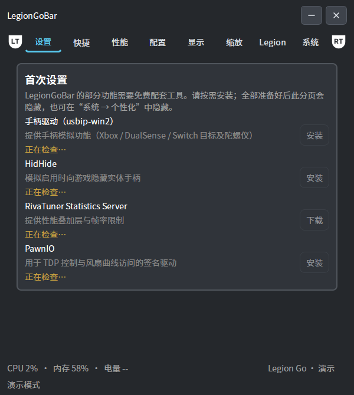
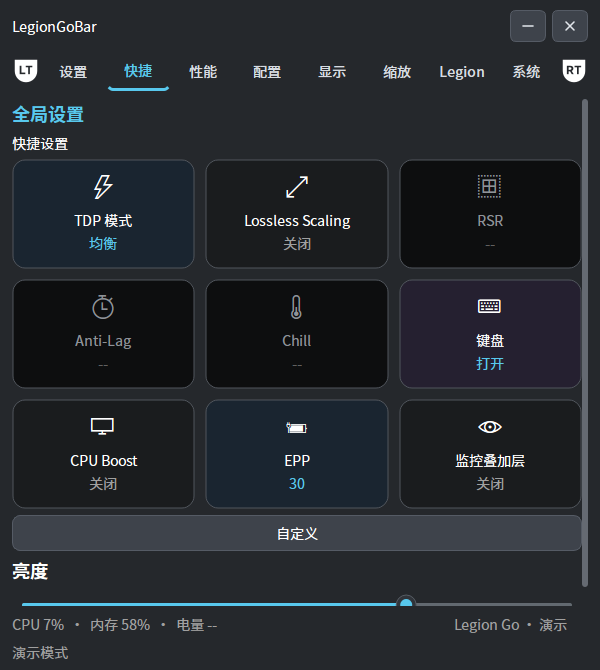
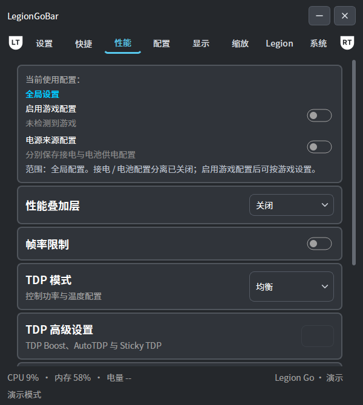
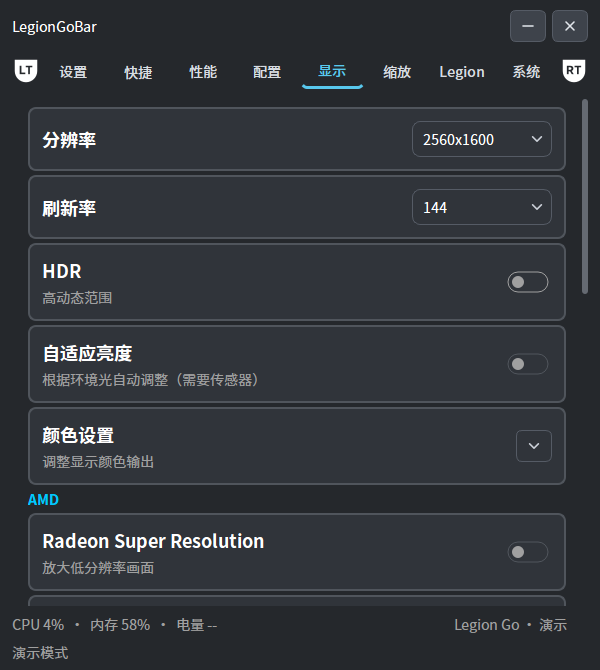
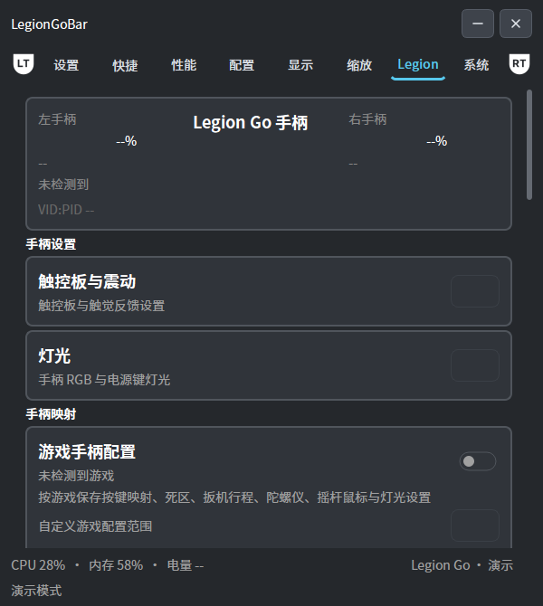

# LegionGoBar

**作者：SUNNYQUAN**

LegionGoBar 是面向第一代 **Lenovo Legion Go** 的独立掌机控制前端，以 **Python + PySide6（Qt）** 实现。项目以 [GoTweaks](https://github.com/corando98/GoTweaks) 为复刻基准，目标是完整复现其界面与功能，提供性能调节、显示设置、手柄控制和游戏配置等常用功能。

程序独立运行，无需 Xbox Game Bar、Xbox App 或 Legion Space 前端。日常使用采用无边框窗口，支持触屏、键鼠和手柄导航，并提供简体中文与英文界面。界面内置 Noto Sans CJK SC 字体，统一中英文排版与平滑渲染。

## 界面演示

以下图片由 LegionGoBar 实际运行并截图，使用演示模式展示界面。

### 首次设置



### 快捷设置



### 性能设置



### 显示设置



### Legion Go 控制



## 功能

- **快捷控制**：性能模式、CPU Boost、EPP、亮度和常用功能磁贴。
- **性能调节**：TDP 与加速功率、Sticky TDP 偏移恢复、Windows 电源模式、CPU 能效偏好。
- **AutoTDP**：基于 RTSS 帧率采样的保守 PID 功率调节，支持目标帧率、功率上下限与失焦暂停；Q-Learning／SARSA 学习模式尚未移植。
- **性能叠加层**：RTSS OSD 基础监控，支持项目选择、排序、列数、字号、颜色、透明度和时钟格式。
- **帧率限制**：通过已安装并运行的 RTSS 控制全局帧率上限，支持关闭限制、恢复上次上限与运行状态检测。
- **Legion Go 设备控制**：性能模式、风扇、充电上限、RGB 灯光、触控板、震动、摇杆、扳机与陀螺仪设置；背键支持手柄动作、键盘组合与鼠标操作映射。
- **显示与图形**：分辨率、刷新率、HDR、AMD 显示颜色，以及按驱动能力提供的 AMD RSR、Anti-Lag、Boost、Chill、锐化与 AFMF 设置。
- **Lossless Scaling 集成**：启动程序、显示窗口、按游戏选择配置、克隆与重置配置、保存并重启，以及按 LS 快捷键触发缩放。
- **游戏配置**：按游戏可执行文件自动切换设置，支持共用、接电（AC）与电池（DC）配置，返回桌面时恢复全局设置，支持 JSON 导入与导出、原版 GameProfile／GoTweaksProfiles XML 导入和配置保存范围选择。
- **系统电源**：接电／电池分别设置电源按钮动作、熄屏时间和空闲休眠时间；空闲计时考虑键鼠、手柄与系统恢复。
- **快捷键**：可为快捷磁贴绑定全局键盘快捷键及 Menu／View 手柄组合，支持冲突检查。
- **桌面使用**：托盘、全局唤出快捷键、手柄导航、无边框窗口与调试窗口模式。
- **多语言**：简体中文、英文和跟随系统语言；可在系统分页即时切换。

项目正在开发中，尚未完成全部原版功能移植。虚拟手柄／VIIPER、学习型 AutoTDP、完整 OSD 图表与部分设备功能仍在开发。功能可用性取决于设备、固件、驱动及已安装的配套软件；完整的功能对照见 [复刻进度](docs/PARITY.md)。

## 安装与运行

### 便携版

解压便携版后运行 `LegionGoBar.exe`，保留同目录下的 `_internal` 文件夹。

### 从源码运行

环境要求：Windows x64、Python 3.11 或更新版本。

```powershell
git clone https://github.com/ilworkcn/LegionGoBar.git
cd LegionGoBar
python -m venv .venv
.venv\Scripts\python.exe -m pip install -e ".[dev]"
.venv\Scripts\python.exe -m legiongobar
```

## 使用方式

- 按 `Ctrl+Alt+G` 唤出窗口。
- 拖动顶部标题区域移动窗口，拖动右下角调整大小。
- 关闭窗口后收进托盘；通过托盘菜单的“退出”结束程序。
- 手柄方向键导航，`A` 确认，`B` 返回，`LT / RT` 切换分页。
- 在“系统 → 语言”中切换简体中文、English 或跟随系统。

日常启动默认使用无边框窗口。调试时可启用标准窗口边框：

```powershell
LegionGoBar.exe --windowed
LegionGoBar.exe --lang zh-CN
LegionGoBar.exe --lang en-US
LegionGoBar.exe --demo
```

源码运行也接受相同参数，例如：

```powershell
.venv\Scripts\python.exe -m legiongobar --windowed --lang zh-CN
```

| 参数 | 用途 |
| --- | --- |
| `--windowed` / `--debug-window` | 使用系统标题栏与标准窗口边框 |
| `--lang auto / zh-CN / en-US` | 指定本次启动的界面语言 |
| `--demo` | 演示模式，预览界面与操作 |
| `--no-tray` | 关闭托盘，关闭窗口即退出 |
| `--data-dir PATH` | 指定配置保存目录 |
| `--diagnose` | 输出设备能力诊断 |
| `--diagnostic-output PATH` | 将设备诊断保存为 JSON |

配置默认保存在 `%LOCALAPPDATA%\LegionGoBar\settings.json`。

## 开发

代码按界面、配置和设备接口划分，使用中文注释。界面翻译位于 `src/legiongobar/locales/`，原始界面参考保存在 `reference/`。

```powershell
.venv\Scripts\python.exe -m pytest -q
powershell -ExecutionPolicy Bypass -File tools\build.ps1 -Python .venv\Scripts\python.exe
```

## Credits

感谢 [corando98/GoTweaks](https://github.com/corando98/GoTweaks) 提供原始界面、交互设计与设备控制实现。本项目以该仓库为完整复刻目标；开发时使用的本地 `GoTweaks-Desktop` 是其 fork。

LegionGoBar 的作者为 **SUNNYQUAN**。本项目代码使用 [MIT License](LICENSE)，第三方代码、参考资料和依赖的许可声明见 [Third-party notices](THIRD-PARTY-NOTICES.md)。
